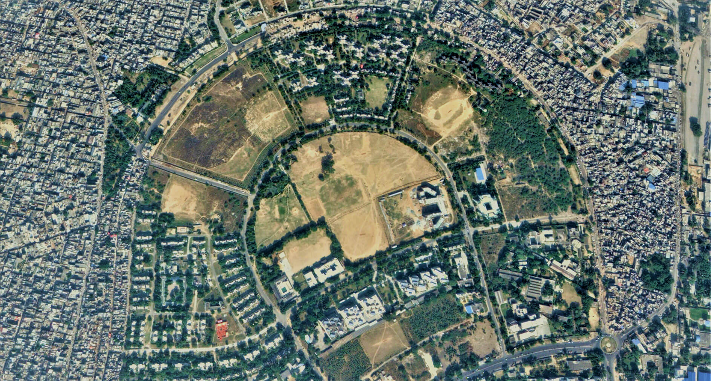
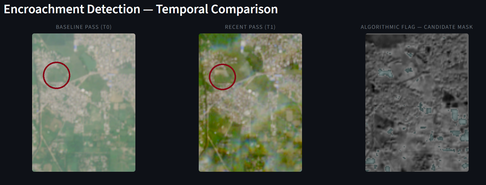

# GroundTruth — DTP Enforcement Radar & UHI Risk Pipeline



> *"Concrete is permanent. Vegetation loss is detectable in 10 days. We built the radar that catches it first."*

**GroundTruth** is an automated satellite surveillance dashboard built for the **District Town Planner (DTP) of Faridabad**. It is an on-demand early-warning radar that detects suspected unpermitted plot carving on agricultural land — **before a single bag of cement is poured**.

By identifying ~1 ha vegetation loss events, the pipeline flags the destruction of critical thermal buffers with the goal of enabling government enforcement at the only moment that matters: the clearing stage. It fuses **AWS Open Data**, morphological algorithms, and **Multimodal Generative AI (Amazon Bedrock / Claude)** into an actionable GovTech decision-support tool.

*Built for the **WeMakeDevs / AWS Environment Hackathon**.*

---

## 📖 Table of Contents
- [The Environmental Case — Why UHI Matters](#-the-environmental-case--why-uhi-matters)
- [The Core Insight — Why Standard Maps Fail](#-the-core-insight--why-standard-maps-fail)
- [Hackathon Track](#-hackathon-track)
- [AWS Cloud-Native Architecture](#-aws-cloud-native-architecture)
- [Key Features](#-key-features)
- [Folder Structure](#-folder-structure)
- [Ground-Truth Benchmark — Known-Site Case Study](#-ground-truth-benchmark--known-site-case-study)
- [Results & Benchmarks](#-results--benchmarks)
- [Limitations & Guardrails](#-limitations--guardrails)
- [Installation & Setup](#-installation--setup)
- [Responsible Use](#-responsible-use)

---

## 🌍 The Environmental Case — Why UHI Matters

**Urban Heat Islands (UHIs) are not an accident — they are built, plot by plot.**

Every hectare of agricultural land or Aravalli scrub forest that is scraped bare and paved over permanently removes a cooling buffer. The mechanism is straightforward:

1. **Vegetation is cleared** — NDVI drops, latent heat flux collapses.
2. **Bare soil bakes and dries** — albedo shifts, sensible heat rises.
3. **Concrete is poured** — the thermal mass is locked in forever.

**Window of intervention: steps 1–2 only. GroundTruth monitors exactly this window.**

Once concrete is poured, enforcement becomes a legal battle lasting years. GroundTruth gives the DTP a **satellite-verified, AI-triaged field inspection order** within hours of the clearing event — while the ground is still bare.

---

## 🔭 The Core Insight — Why Standard Maps Fail

| Tool | Refresh Rate | What you see |
|------|-------------|--------------|
| Google Maps | 1–3 **years** | The building that is already there |
| Esri World Imagery | 6–12 **months** | The colony that is already paved |
| **GroundTruth (Sentinel-2)** | **5–10 days** | The dirt that was just scraped |

Google Maps is an **archive**. GroundTruth is a **radar**.

---

## 🏆 Hackathon Track

**Heat and Water** — *WeMakeDevs / AWS Environment Hackathon*

This pipeline directly supports the hackathon theme by:
- **Detecting the earliest measurable signal** of Urban Heat Island formation — vegetation clearing.
- **Empowering government enforcement** to halt encroachment before permanent thermal damage occurs.
- **Quantifying ecological risk** using FMDA baseline land use (agricultural, forest, waterbody proximity) to prioritize the highest-impact sites first.

---

## ☁️ AWS Cloud-Native Architecture

GroundTruth is built entirely on AWS services, with no proprietary satellite data costs:

```
┌─────────────────────────────────────────────────────────────────┐
│                    AWS Open Data Registry (S3)                  │
│         Sentinel-2 L2A Cloud-Optimized GeoTIFFs (COGs)         │
│         No egress cost · 10m resolution · 5-day revisit        │
└──────────────────────┬──────────────────────────────────────────┘
                       │  pystac-client windowed COG reads
                       ▼
┌─────────────────────────────────────────────────────────────────┐
│                    core/stac_ingestion.py                       │
│   STAC scene pair selection · SCL cloud masking · NDVI Δ calc  │
│   MGRS tile-aligned COG window reads (no full-scene download)  │
└──────────────────────┬──────────────────────────────────────────┘
                       │  anomaly_mask + clusters
                       ▼
┌─────────────────────────────────────────────────────────────────┐
│             core/detection.py + integrations/fmda.py           │
│  scipy.ndimage clustering · artifact suppression (fill ratio)  │
│  FMDA GIS cross-reference · waterbody proximity scoring        │
└──────────────────────┬──────────────────────────────────────────┘
                       │  ranked cluster list
                       ▼
┌─────────────────────────────────────────────────────────────────┐
│                  Amazon Bedrock (Claude)                        │
│   Multimodal visual reasoning on T0/T1 satellite crop pair     │
│   Returns structured FLAG_FOR_REVIEW | SUPPRESS_NO_ACTION      │
│   Compliance-enforced: never outputs "illegal"/"unauthorized"  │
└──────────────────────┬──────────────────────────────────────────┘
                       │  ReviewReport (Pydantic)
                       ▼
┌─────────────────────────────────────────────────────────────────┐
│                  Amazon S3 (optional)                           │
│   Stores crop JPEG + structured JSON report per cluster ID     │
│   Enables field inspector offline access and audit trail       │
└──────────────────────┬──────────────────────────────────────────┘
                       │
                       ▼
┌─────────────────────────────────────────────────────────────────┐
│           Streamlit Dashboard (Amazon EC2)                      │
│   Detection funnel · Priority queue · Folium satellite map     │
│   FMDA Master Plan overlay · AI report card · UHI metrics      │
└─────────────────────────────────────────────────────────────────┘
```

### AWS Services Used

| Service | Role |
|---------|------|
| **AWS Open Data Registry** | Zero-cost Sentinel-2 L2A COG tiles streamed via STAC |
| **Amazon Bedrock (Claude Sonnet)** | Multimodal T0/T1 crop analysis & enforcement report generation |
| **Amazon S3** | Persistent storage of crop images and structured JSON audit reports |
| **Amazon EC2** | Production deployment of the Streamlit dashboard |
| **AWS IAM** | Least-privilege credentials for Bedrock and S3 access |

---

## 🚀 Key Features

1. **Cloud-Native STAC Ingestion:** Windowed reads of 10m-resolution Sentinel-2 COGs directly from the AWS Open Data Registry (S3) via the Earth Search STAC API — no full-scene downloads, no satellite subscription costs.
2. **Smart Scene Pair Selection:** Automatically selects the optimal T0/T1 scene pair using SCL cloud masking (valid-pixel fraction ≥ 80%), monsoon-aware fallback, and a configurable baseline separation window (10–30 days).
3. **Morphological Pruning:** `scipy.ndimage` connected-component labeling + geometric fill-ratio filter (`≥ 0.65`) automatically suppresses sensor swath-edge artifacts without invoking the AI, reducing unnecessary Bedrock calls.
4. **FMDA GIS Cross-Reference:** Validates each anomaly cluster against the Faridabad Master Plan 2031 (live State GIS Server) and cached FMDA Baseline Land Use survey. Reprojects cluster corners batch-vectorized via `rasterio.warp`.
5. **Amazon Bedrock Multimodal Triage:** Dispatches T0+T1 visual crop pairs to Claude for visual reasoning. Structured `ReviewReport` (Pydantic-validated JSON) enforces compliance phrasing: `"suspected clearing, unverified, licence status not checked"`. Never outputs "illegal" or "unauthorized".
6. **Dynamic Bounding Box Overlays:** FMDA Master Plan and Land Use map overlays are always computed from the **selected cluster's actual coordinates** (±0.011° offset), not a hardcoded location.
7. **Graceful Degradation:** STAC failure → explicit error + bundled sample data button. FMDA tile fetch failure → `None` returned, overlay silently skipped. Bedrock AccessDenied → fail fast, no silent retry.
8. **Priority Scoring:** Fuses NDVI magnitude, disturbance footprint, baseline land use (agriculture/forest bonus), and 100m waterbody proximity into a deterministic priority score that ranks the inspection queue.

---

## 🏗️ Folder Structure

```text
GroundTruth/
├── .streamlit/
│   └── config.toml           # Dark theme configuration
├── core/
│   ├── bedrock.py            # Amazon Bedrock invocation (Claude) + S3 upload
│   ├── detection.py          # NDVI calculation, clustering, artifact suppression
│   └── stac_ingestion.py     # pystac-client scene search, COG window reads, timeseries
├── frontend/
│   └── app.py                # Streamlit dashboard UI (885 lines)
├── integrations/
│   └── fmda.py               # FMDA GIS spatial join, master plan overlay, land-use enrichment
├── utils/
│   └── config.py             # Constants, thresholds, region bounding boxes, land-use colors
├── Data/
│   ├── background_image.jpg  # Hero background
│   ├── t0_b04.tiff / t0_b08.tiff  # Bundled Sentinel-2 sample bands (T0)
│   ├── t1_b04.tiff / t1_b08.tiff  # Bundled Sentinel-2 sample bands (T1)
│   └── cache/                # Pre-warmed STAC NDVI tiles (.npz), land-use (.geojson), scene metadata (.json)
├── scripts/
│   └── prewarm_cache.py      # Offline STAC cache warm-up for all 4 regions
├── requirements.txt
├── .env.example
└── README.md
```

---

## 📊 Ground-Truth Benchmark — Known-Site Case Study

This is the project's anchor ground-truth validation. A real, known clearing event was used as a sanity check of the end-to-end pipeline. This is the same site discussed at the start of the submitted demo video.

**Location:** Faridabad district, Haryana (exact site withheld)  
**Sentinel-2 Window:** Aug 21, 2024 (T0) → Sep 15, 2024 (T1)  

| Metric | Value |
|--------|-------|
| Detected NDVI Drop (Δ) | **−0.321** |
| Estimated Disturbed Area | **~1.02 est. ha** |
| Baseline Land Use (FMDA) | **Agriculture Cropland** |
| Waterbody Proximity | **Outside 100m buffer** |
| Priority Score | **34.5 / 100** |
| Bedrock Verdict | **FLAG_FOR_REVIEW** (Confidence: 0.62) |
| Bedrock Reasoning | *"T0 shows dense green vegetation consistent with cropland; T1 reveals notable spectral brightening and reduced canopy cover along road-adjacent parcels. Timing partially overlaps kharif harvest but extent and pattern suggest suspected clearing, unverified, licence status not checked. Indicative recommendation: ground-truth visit."* |

**Conclusion:** The 1 ha clearing was successfully detected, survived all artifact suppression filters (fill_ratio = 0.31, well below the 0.65 suppression threshold), and received a Claude `FLAG_FOR_REVIEW` verdict in a single API call.

> **Detection floor demonstrated:** ~1 ha at 10m Sentinel-2 resolution.

*Single known site, used as a sanity check, not as statistical validation.*



*The softness and haze in the T1 panel come from the data itself: 10 m Sentinel-2 imagery captured during the August–September monsoon, not from image processing.*

---

## 📈 Results & Benchmarks

### Full Pipeline Smoke Test (Oct 11, 2026)

| Region | Mode | T0 Scene | T1 Scene | Scanned Area | Clusters | Flagged Area |
|--------|------|----------|----------|-------------|----------|--------------|
| Ballabgarh Agro Belt | Historical | S2A_43RGM_20240821 | S2B_43RGM_20240915 | 18,984 est. ha | 222 | 240.6 est. ha |
| Aravalli Ridge Corridor | Historical | S2A_43RGM_20240821 | S2B_43RGM_20240915 | 28,461 est. ha | 338 | 498.2 est. ha |
| Neharpar Urban Ext. | Historical | S2A_43RGM_20240821 | S2B_43RGM_20240915 | 17,641 est. ha | 190 | 245.3 est. ha |
| Entire Faridabad | Historical | S2A_43RGM_20240821 | S2B_43RGM_20240915 | 144,593 est. ha | 1,552 | 2,132.6 est. ha |
| Entire Faridabad | Live | S2C_43RGM_20260930 | S2C_43RGM_20261010 | 144,593 est. ha | 5,585 | 14,405.8 est. ha |

**Performance:** Full-district scan (211,419 raw connected components) completes in **< 0.5 seconds** using `np.bincount` + `ndimage.find_objects` (>100× faster than the naïve per-label mask comparison).

**Forced STAC Failure Test:** STAC failure correctly surfaced as `st.error()` with terminal log. Bundled sample data loaded in < 1s with explicit banner.

**Bedrock Dispatch:** Cluster 3139 → `FLAG_FOR_REVIEW`, Confidence 0.62, compliance phrasing verified.

---

## 🚧 Limitations & Guardrails

### Known Limitations & Roadmap
- **Resolution Floor:** Sentinel-2 10m resolution; reliable minimum detection ~0.5–1 ha. Sub-0.5 ha clearings may be missed.
- **Monsoon Blindspot & Sentinel-1 SAR Roadmap:** Indian monsoon (July–September) cloud cover limits optical satellite availability. Integrating Sentinel-1 Synthetic Aperture Radar (SAR) is on our immediate roadmap, providing all-weather, cloud-penetrating capabilities and turning the monsoon-season optical blindspot into a 365-day enforcement net.
- **Terrain Shadows:** Aravalli ridge shadow angles in winter can trigger marginal NDVI drops. Temporal persistence tracking (planned) will filter these.
- **Seasonal Agriculture:** Kharif harvest mimics plot carving. Claude is explicitly instructed to weigh seasonal patterns; confidence scores reflect this uncertainty.

### Guardrails
- **Bounded Scans:** 4 preset regional bounding boxes cap memory and STAC query volume.
- **AI is Triage Only:** `FLAG_FOR_REVIEW` dispatches a human field inspector. The AI makes no legal finding. Compliance language is enforced at the prompt level.
- **No "illegal":** The word "illegal" or "unauthorized" **is prohibited** in AI output via the prompt and was checked in smoke tests (a prompt-level control, not a hard guarantee).
- **Dynamic Cache:** All STAC tiles, land-use GeoJSON, and scene metadata cached on disk by bbox hash. No redundant AWS egress after warm-up.

---

## 🛠️ Installation & Setup

### 1. Clone
```bash
git clone https://github.com/gaurvais/groundtruth.git
cd groundtruth
```

### 2. Environment Variables
Copy `.env.example` to `.env` and fill in your AWS credentials. Bedrock requires access to Claude Sonnet in your configured AWS region.

```env
AWS_ACCESS_KEY_ID=your_access_key
AWS_SECRET_ACCESS_KEY=your_secret_key
AWS_DEFAULT_REGION=ap-southeast-2
GROUNDTRUTH_BEDROCK_MODEL=au.anthropic.claude-sonnet-4-6
GROUNDTRUTH_S3_BUCKET=your-s3-bucket   # optional — enables S3 report upload
```

### 3. Install & Run
```bash
pip install -r requirements.txt
streamlit run frontend/app.py
```

### 4. Pre-Warm Cache (Recommended)
```bash
python scripts/prewarm_cache.py
```
This pre-fetches Sentinel-2 tiles for all 4 regions and caches FMDA land-use data so the live app loads instantly.

---

## ⚖️ Responsible Use

This pipeline generates **Decision Support** data, not legal findings.

- All outputs (including `FLAG_FOR_REVIEW`) are designed to **prioritize and dispatch physical government field inspectors**, not to initiate legal proceedings.
- Amazon Bedrock / Claude is used strictly as a **pixel-pattern triage assistant**, fully decoupled from any statutory legal judgment.
- All AI output uses the mandated phrasing: *"suspected clearing, unverified, licence status not checked"* and labels any reclamation guidance as *"indicative"*.
- No personally identifiable information is processed at any stage.